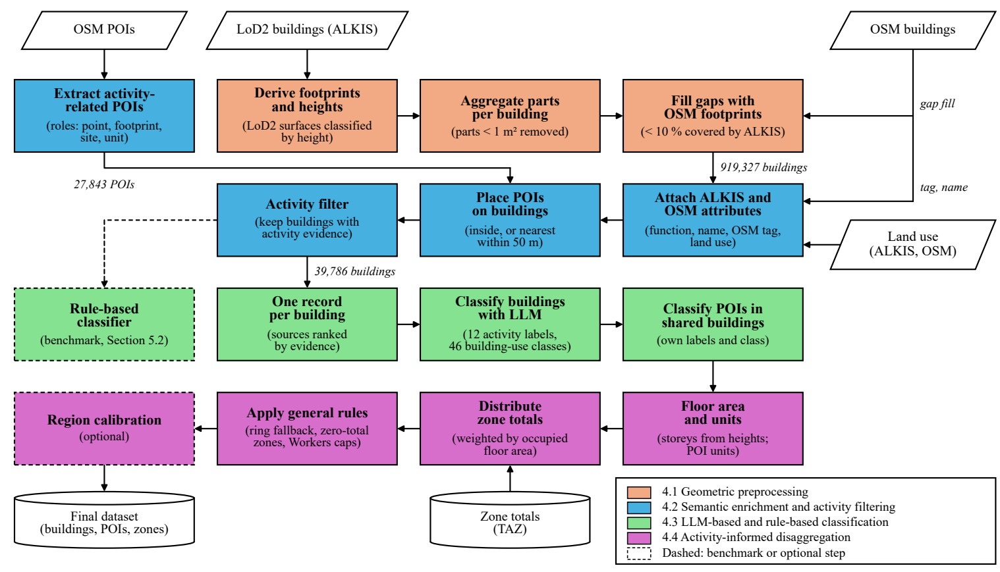

# Activities and Potentials Calculation Pipeline

> **Institution:** [Institute of Transportation and Urban Engineering](https://www.tu-braunschweig.de/ivs), TU Braunschweig
> **Authors:** Mayur Patel, Lasse Bienzeisler, Bernhard Friedrich

[](CITATION.cff)
[-blue?logo=python)](https://www.python.org/)
[](LICENSE)

This repository holds the pipeline behind the paper *Deriving Activities and Their Potentials at Building-Level Using
Large Language Models* (Patel, Bienzeisler, Friedrich; EWGT 2026, under review). It is the final implementation for
the paper's study area, the region of the Regionalverband Großraum Braunschweig (Lower Saxony, Germany).

## What it does

Agent-based travel demand models need to know which activities take place in each building and how many people
they attract. Such data are usually available only as totals per traffic zone. The pipeline derives them per
building, from official building data (LoD2 / ALKIS), OpenStreetMap (OSM) and a large language model (LLM):

- **Activity labels** of every building of activity: zero or more of 12 labels derived from the trip purposes of
  the German travel survey MiD (`work`, `school`, `retail_daily`, `leisure`, `errands`, …;
  `config.LLM_ACTIVITY_LABELS`).
- **Building-use class**: one of 46 classes after Bosserhoff (2000), 8 main groups and 38 subclasses
  (`config.LLM_BOSSERHOF_SUBCATEGORIES`), each with a worker density per 100 m² of floor area.
- **Activity potentials**: each building's and each POI unit's share of seven zone totals of the region's travel
  demand model (workers; school, university and kindergarten places; daily and non-daily shopping; leisure),
  distributed by occupied floor area, plus visitor estimates for five activities without a zone total.

A deterministic rule-based classifier ([`rules/`](rules/)) classifies the same buildings without an LLM and serves
as the benchmark in the paper.

## Workflow



*Fig. 1 of the paper: the four stages (colours) and their steps. Dashed: the benchmark classifier and the region
calibration. In this implementation step 07 asks the LLM for the POIs' activity labels only, and a POI's
building-use class is set by rule in step 08 from its OSM use (else the building's class applies). The region
calibration is part of the configuration and always applied ([`REDISTRIBUTION.md`](REDISTRIBUTION.md)).*

Run the notebooks in this order; each reads only the outputs of earlier steps.

| Step | Notebook | Paper stage | What it does | Main output (`data/output/`) |
|---|---|---|---|---|
| 01 | [`01_osm_extraction`](pipeline/01_osm_extraction.ipynb) | 4.2 | Clips the OSM extract to the study area; extracts activity-related POIs (27,843), building footprints and land use | `01_all_pois.gpkg`, `01_all_buildings_osm.gpkg`, `01_landuse_osm.gpkg` |
| 02 | [`02_alkis_extraction`](pipeline/02_alkis_extraction.ipynb) | 4.1 | Selects, downloads and merges the region's LoD2 tiles | `02_alkis_lod2_raw.gpkg` |
| 03 | [`03_alkis_refinement`](pipeline/03_alkis_refinement.ipynb) | 4.1 | Classifies LoD2 surfaces into ground, wall and roof; derives footprints, eaves and ridge heights per building (869,316) | `03_alkis_by_building.gpkg` |
| 04 | [`04_semantic_enrichment`](pipeline/04_semantic_enrichment.ipynb) | 4.1, 4.2 | Adds OSM footprints missing from ALKIS (919,327), attaches functions, names and land use, places POIs on buildings, keeps the 39,786 buildings of activity | `04_buildings_enriched.gpkg` |
| 05 | [`05_llm_classification`](pipeline/05_llm_classification.ipynb) | 4.3 | Builds one text record per building and asks the LLM for its labels and class (full run: [`scripts/05_run_llm.py`](scripts/05_run_llm.py)) | `05_llm_answers.jsonl` |
| 06 | [`06_llm_assembly`](pipeline/06_llm_assembly.ipynb) | 4.3 | Puts the answers on the buildings; adds `work` by rule | `06_buildings_classified.gpkg` |
| 07 | [`07_poi_classification`](pipeline/07_poi_classification.ipynb) | 4.3 | Asks the LLM for the labels of each POI in a shared building (full run: [`scripts/07_run_llm_pois.py`](scripts/07_run_llm_pois.py)) | `07_building_pois_classified.gpkg` |
| 08 | [`08_redistribution`](pipeline/08_redistribution.ipynb) | 4.4 | Derives storeys and occupied floor area; distributes the zone totals; estimates the five unconstrained activities | `08_redistribution.gpkg` |
| rules | [`classify_buildings`](rules/classify_buildings.ipynb) | 4.3 | Benchmark classifier, after step 04 | `rules_classification.parquet` |

Each notebook opens with its purpose, inputs, outputs, requirements and steps. Notebooks 01–07 and the rules
notebook keep the saved outputs of the run behind the paper; notebook 08's outputs are removed because they derive
from zone data that is not public. Every setting is in [`config.py`](config.py), with its reasoning in the comments;
shared code is in [`lib/`](lib/). [`REDISTRIBUTION.md`](REDISTRIBUTION.md) explains step 08.

## Requirements

**Software.** Python 3.13 (the only version tested) with the packages of [`requirements.txt`](requirements.txt),
and two system tools: `osmium` (step 01) and GDAL's `ogr2ogr` (step 02).

```bash
git clone https://github.com/TUBS-IVS/Activities-and-Potentials-Calculation-Pipeline.git
cd Activities-and-Potentials-Calculation-Pipeline
conda create -n capacity python=3.13 && conda activate capacity
conda install -c conda-forge osmium-tool gdal
pip install -r requirements.txt
pytest rules/tests                                   # 167 tests of the rule classifier, no data needed
```

**Configuration.** All settings are in `config.py`. Inputs are read from `data/input/` (or the folder named by the
environment variable `CAPACITY_INPUT_DIR`); outputs go to `data/output/`. Steps 05 and 07 call the KI-Toolbox of
TU Braunschweig (`LLM_API_URL`, model `gpt-oss-120b` in `LLM_MODEL`), which is available to members of TU
Braunschweig only; its token goes in a git-ignored `.env` file as `TU_KI_TOOLBOX_TOKEN=...`. To use another chat
endpoint, change `LLM_API_URL` and `LLM_MODEL` and adapt the request in [`lib/llm_client.py`](lib/llm_client.py).

**Input data.** [`DATA.md`](DATA.md) gives each input's version, source, terms and expected path.

| Input | Version used | Access |
|---|---|---|
| OpenStreetMap extract of Lower Saxony (`niedersachsen-260910.osm.pbf`) | data up to 2026-09-10T20:21Z | open: [Geofabrik](https://download.geofabrik.de/europe/germany/niedersachsen.html), ODbL |
| LoD2 building models: tile index `lgln-opengeodata-lod2.geojson`, tiles downloaded by step 02 | data currency 2024-05 to 2024-08; tiles downloaded 2026-09-08 | open: [LGLN OpenGeoData](https://opengeodata.lgln.niedersachsen.de/), CC BY 4.0 |
| ALKIS land use (`FS_LN_03_NI_260101.gpkg`) | reference date 2026-01-01 | open: [LGLN STAC catalogue](https://alkis.stac.lgln.niedersachsen.de/collections/alkis-landnutzung), CC BY 4.0 |
| Study-area polygon (`regionalverband_area.gpkg`) | — | any polygon of the study area |
| Reference tables of step 04 (ALKIS function codelist, activity map per code) | — | **included** in [`data/reference/`](data/reference/) |
| Zone totals (`zone_targets.gpkg`, VISUM structure data, 880 zones), step 08 only | — | **restricted**: supplied by the Regionalverband Großraum Braunschweig; not public and not part of this repository |

## What runs without the restricted data

| Available | What you can run | What you get |
|---|---|---|
| Open data only | steps 01–04 and `rules/` | buildings of activity with their POIs, functions and land use; rule-based labels and classes |
| Open data and an LLM endpoint | steps 01–07 and `rules/` | LLM labels and classes per building, labels per POI; results will differ from the paper's (see below) |
| Open data, an LLM endpoint and lawful access to the zone totals | steps 01–08 | the activity potentials |

Step 08 cannot run without `zone_targets.gpkg`: it stops at its input check and writes nothing. The quantities it
derives from open data — storeys, floor area, occupied floor area, a worker estimate from floor area × the
Bosserhoff density, and the visitor estimates of the five unconstrained activities — are computed inside step 08 and
partly tied to zone membership (a building outside every zone gets no visitor estimate). This version therefore
offers no open-data estimate of potentials; producing one would need changes to step 08, and its values would not
match the zone-constrained results.

## Outputs

`08_redistribution.gpkg` has three layers: `buildings` (39,786: class, labels, storeys, floor area, occupied floor
area, `assigned_<category>` for the seven categories, `value_<label>` for the five estimates, `value_assumed`),
`pois` (7,864 POI units of shared buildings, same values) and `zones` (each zone's total and the sum placed on its
buildings). The step outputs are not distributed: the classification outputs derive from OSM (ODbL) and LGLN data
(CC BY 4.0), and every step-08 output derives from the restricted zone totals, which can be recovered by summing
`assigned_<category>` by zone.

## Limitations

- The zone totals are restricted, so the activity potentials can be reproduced only with lawful access to them.
- The LLM endpoint offers no temperature or seed control; re-running steps 05 and 07 can give different answers. The
  answers behind the paper are not distributed.
- The open inputs are served in their current release; the versions above must be obtained to rebuild the same data.
- Some settings hold published facts of the Braunschweig region (staff numbers of large institutions, retail floor
  areas of shopping centres, hand-checked building lists); they do not transfer to other regions
  ([`REDISTRIBUTION.md`](REDISTRIBUTION.md)).
- The five unconstrained activities are estimates from visitor rates per floor area, partly assumed; they are not
  scaled to any total.

A transferable version of the pipeline for other regions is under development.

## Version and reproducibility

This is **Version 1** (tag [`v1.0.0`](https://github.com/TUBS-IVS/Activities-and-Potentials-Calculation-Pipeline/releases/tag/v1.0.0)).
The paper's results were produced with the code at commit
[`60469fa`](https://github.com/TUBS-IVS/Activities-and-Potentials-Calculation-Pipeline/commit/60469fa22244bf4af3ed456a4d1fff4ae0eda34b);
Version 1 differs from it only in documentation, comments, notebook text and saved outputs, and the added reference
tables, not in any calculation. [`REPRODUCIBILITY.md`](REPRODUCIBILITY.md) lists runtimes, what can and cannot be
reproduced, and what was checked. The paper validates the classification on a sample of buildings of the region;
the validation data and code are not part of this repository.

## Repository structure

```
.
├── config.py              ← every setting, with the reasoning behind it
├── pipeline/              ← steps 01–08 as notebooks
├── lib/                   ← shared code: LLM record, routing, client and run; floor-area, label and headcount rules of step 08
├── scripts/               ← full LLM runs (05, 07); optional QGIS review project of step 08 (run with QGIS's Python)
├── rules/                 ← rule-based classifier: rule_utils.py, its config, notebook, tests
├── figures/               ← the pipeline overview (Fig. 1 of the paper)
├── data/
│   ├── input/             ← input data (not tracked)
│   ├── output/            ← step outputs (not tracked)
│   ├── reference/         ← the two reference tables of step 04 (tracked)
│   └── experimental_extract/  ← QGIS review layers (not tracked)
├── DATA.md                ← input data: version, source, terms, expected path
├── REDISTRIBUTION.md      ← method note on step 08
├── REPRODUCIBILITY.md     ← execution order, runtimes, what can be reproduced
└── requirements.txt
```

## Licence

The code, notebooks and documentation are released under the [MIT Licence](LICENSE). The licence does not cover
the input data, which keep their own terms:

- OpenStreetMap: © OpenStreetMap contributors, [Open Database Licence (ODbL)](https://opendatacommons.org/licenses/odbl/).
- LoD2 building models and ALKIS land use: © GeoBasis-DE/LGLN, [CC BY 4.0](https://creativecommons.org/licenses/by/4.0/);
  results derived from them carry the source note "© GeoBasis-DE/LGLN <year of download>, Daten geändert".
- Zone totals: Regionalverband Großraum Braunschweig; not public, not redistributable without their permission.

## Citation

Please cite the software via [`CITATION.cff`](CITATION.cff) (GitHub's "Cite this repository" button) and the paper:
Patel, M., Bienzeisler, L., Friedrich, B.: *Deriving Activities and Their Potentials at Building-Level Using Large
Language Models*, EWGT 2026 (under review).

## Acknowledgements

This work is part of the **TRANSFORMPATHS** project, funded by the Federal Ministry of Research, Technology and Space
(BMFTR) within the framework of "Research for Sustainability" (FONA), under grant number **01UV2574A**. The authors
thank the [Regionalverband Großraum Braunschweig](https://www.regionalverband-braunschweig.de/) for data provision and
the Gauß-IT-Zentrum of TU Braunschweig for LLM infrastructure.

## Contact

**Mayur Patel**, Institute of Transportation and Urban Engineering, TU Braunschweig
m.patel@tu-braunschweig.de · Tel.: +49-531-391-66809
